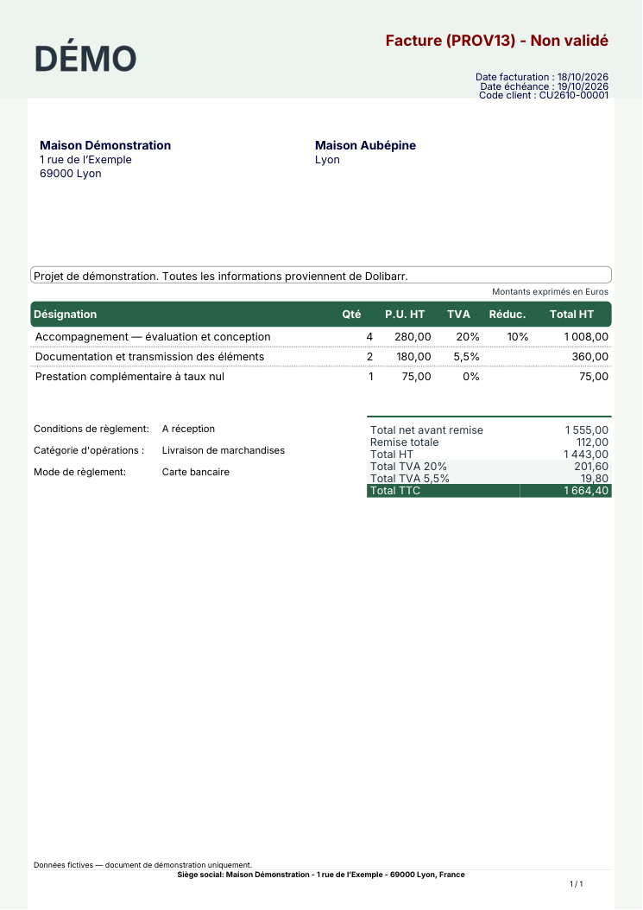
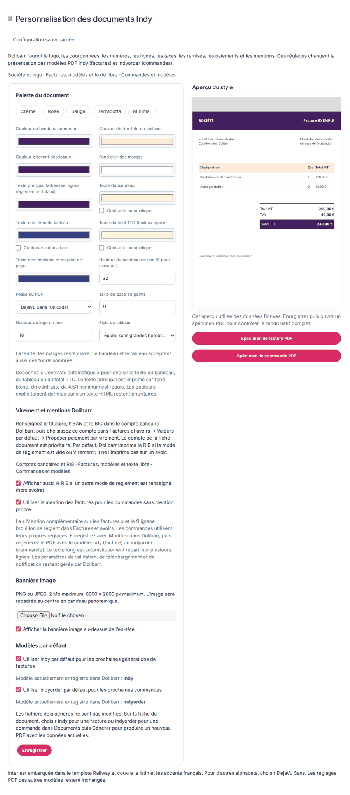

# Documents Indy

Modèles PDF natifs et personnalisables pour **Dolibarr 24.0.2** : **indy** pour les factures et avoirs, **indyorder** pour les commandes. Leur présentation est indépendante du thème de l’interface web.

[Facture crème](docs/exemple-facture-indy.pdf) · [Facture sauge](docs/exemple-facture-sauge.pdf) · [Facture avec bannière image](docs/exemple-facture-banniere.pdf) · [Bon de commande](docs/exemple-commande-indy.pdf) · [Virement et mentions longues](docs/exemple-facture-virement.pdf). Ces exemples ne contiennent que des données fictives.

## Installation et accès

Le code et les polices sont livrés dans l’image Docker, dans `htdocs/indyinvoice`. Les réglages restent dans MariaDB ; la bannière est conservée dans `documents/indyinvoice/banner-<entité>.png`, sur le volume persistant du template.

1. Déployer l’image puis activer **Documents Indy** dans **Configuration → Modules / Applications**. Le module conserve son identifiant technique `IndyInvoice`.
2. Ouvrir sa roue de configuration : **Personnalisation des documents Indy**.
3. Choisir une palette, modifier les couleurs, la police, la taille, la hauteur du logo et du bandeau, puis éventuellement ajouter une image PNG/JPEG.
4. Cocher séparément le modèle par défaut des **factures** et celui des **commandes**, puis enregistrer. La case reflète la valeur réellement enregistrée après rechargement. La décocher restaure le modèle précédent, ou le modèle natif s’il n’existe plus.
5. Enregistrer puis ouvrir un **spécimen PDF** pour contrôler le rendu complet. L’aperçu à droite utilise des données fictives.

Une mise à jour rend les nouveaux modèles disponibles et renouvelle le cache du thème, sans changer les modèles par défaut ni les documents métier existants.

## Pourquoi une commande peut-elle encore produire un PDF classique ?

Un document généré depuis une **commande** est un bon de commande, pas une facture. Dolibarr utilise deux préférences distinctes :

| Document | Modèle Indy | Modèle natif | Préférence Dolibarr |
| --- | --- | --- | --- |
| Facture / avoir | `indy` | `sponge` | `FACTURE_ADDON_PDF` |
| Commande | `indyorder` | `eratosthene` | `COMMANDE_ADDON_PDF` |

Le choix par défaut concerne les prochaines créations/générations qui utilisent ce défaut. Une fiche existante peut conserver son propre modèle et son ancien PDF.

Sur un brouillon existant : dans **Fichiers joints / Documents → Modèle de document**, sélectionner **indyorder** pour une commande, ou **indy** pour une facture, puis **Générer**. Le bouton natif peut remplacer le PDF principal : conserver une copie si nécessaire. Le changement des couleurs ou l’activation du module ne réécrit aucun fichier déjà généré.

Pour obtenir une facture à partir d’une commande, utiliser ensuite le parcours natif de facturation de Dolibarr. Le générateur de bon de commande ne convertit pas la commande en facture.

## Personnalisation disponible

- Cinq palettes de départ : crème, rose, sauge, terracotta et minimal ; toutes les couleurs restent modifiables.
- Couleur et hauteur du bandeau, couleur de l’en-tête du tableau et accent des totaux. Couleurs de texte distinctes pour le contenu, le bandeau, les titres du tableau, le total TTC et le pied de page. Le mode automatique choisit un texte lisible ; le désactiver pour choisir sa couleur. Un contraste minimal de 4,5:1 est requis à l’enregistrement.
- Teinte claire des marges ; le contenu reste sur fond blanc. Les mises en page intégralement foncées de certaines références Indy ne sont pas reproduites par ces modèles natifs.
- Inter, Helvetica, DejaVu Sans, Times et DejaVu Serif ; taille de base de 9 à 12 points ; logo de 8 à 24 mm.
- Tableau épuré ou encadré natif. Le mode encadré conserve les fonds natifs des totaux ; la couleur du texte principal s’y applique aussi.
- Bannière panoramique facultative au-dessus de l’en-tête : PNG/JPEG, maximum 2 Mo et 6000 × 2000 px, recadrage au centre en 1680 × 160 px, réencodage PNG sans métadonnées. L’image est privée aux administrateurs dans les réglages et apparaît sur les PDF générés.

La hauteur du bandeau sert de base : elle s’étend si nécessaire pour ne pas couper une ligne de référence native. Sur un bandeau sombre, choisir un logo clair ou adapté : le module ne recolore pas les images. Les couleurs explicitement indiquées dans un texte HTML natif restent prioritaires.

Le logo conserve sa transparence d’origine. Un logo JPEG à fond blanc reste blanc : utiliser un PNG transparent dans les réglages société si souhaité.

## Données contrôlées par Dolibarr

| Élément | Source |
| --- | --- |
| Logo et coordonnées de l’émetteur | Configuration → Société / Organisation |
| Client et contact de facturation | Fiche du tiers et contacts du document |
| Numéro, dates, références | Document et numérotation native |
| Produits, unités et descriptions | Lignes du document ; activation native des unités |
| Quantités, remises, TVA, totaux, avoirs et paiements | Générateurs natifs Sponge et Eratosthene |
| Échéance, mode de règlement, banque | Document et réglages natifs du module concerné |
| Mentions et texte libre | Réglages natifs Factures / Commandes et société |
| Marges, langue et informations légales | Options PDF et société natives |

La catégorie d’opérations utilise l’emplacement natif sous les conditions de règlement pour éviter de recouvrir la note publique. Le module ne contient aucune adresse, information bancaire ou mention fiscale d’une entreprise réelle. Il ne modifie ni les montants ni le statut d’un document.

Les préférences PDF temporaires sont restaurées après chaque génération. Les variantes multidevises et bilingues conservent le tableau natif. Les polices Inter couvrent le latin et les accents français, sous [SIL OFL](fonts/OFL.txt). Les modules tiers et évolutions majeures de Dolibarr doivent être vérifiés avec les documents concernés.

## Afficher le RIB et les informations de virement

1. Dans **Banques / Caisses**, renseigner le compte bancaire natif : titulaire, banque, IBAN et BIC. Les informations restent dans Dolibarr.
2. Dans **Configuration → Modules → Factures et avoirs**, sélectionner ce compte dans **Valeurs par défaut → Proposer paiement par virement sur le compte**, puis cliquer **Modifier**.
3. Sur la facture, choisir le mode **Virement**. Le RIB apparaît aussi lorsque le mode est vide. Un compte choisi sur la fiche du document est prioritaire sur le compte par défaut ; la compatibilité native avec `fk_bank` est conservée.
4. Si le document doit conserver un autre mode de règlement, activer **Afficher aussi le RIB si un autre mode de règlement est renseigné** dans Documents Indy. L’option utilise le même compte natif, sans ajouter deux fois le bloc bancaire et sans le proposer sur les avoirs.
5. Régénérer le PDF avec `indy`, ou `indyorder` sur une commande. Une ancienne génération reste inchangée jusqu’à cette action.

Les instructions complémentaires de virement peuvent être saisies dans la mention native du document : par exemple « Indiquer le numéro de facture dans le libellé du virement ». Les balises proposées par l’aide native restent disponibles. Les paiements, QR codes et communications structurées natifs conservent leurs propres conditions d’activation.

## Faire apparaître la mention complémentaire et le filigrane

| Réglage natif | PDF concerné | Comportement |
| --- | --- | --- |
| Mention complémentaire sur les factures (`INVOICE_FREE_TEXT`) | Facture / avoir `indy` | Texte libre natif en bas de la dernière page, retours à la ligne et substitutions conservés |
| Mention complémentaire des commandes (`ORDER_FREE_TEXT`) | Commande `indyorder` | Mention propre à la commande |
| Utiliser la mention des factures pour les commandes sans mention propre | Commande `indyorder` | Reprise facultative de la mention facture, uniquement si la mention commande est vide |
| Filigrane brouillon facture (`FACTURE_DRAFT_WATERMARK`) | Facture encore en brouillon | Filigrane natif ; ne concerne pas un bon de commande ni une facture validée |
| Filigrane brouillon commande (`COMMANDE_DRAFT_WATERMARK`) | Commande encore en brouillon | Réglage natif distinct de celui des factures |

Après saisie dans la configuration native, cliquer **Modifier**, puis régénérer le document. Enregistrer les couleurs dans Documents Indy n’enregistre pas un formulaire ouvert sur une autre page.

Le modèle mesure les mentions à la largeur réelle du document et réserve leur hauteur avant la pagination : les longs paragraphes se répartissent sur plusieurs lignes et restent au-dessus du pied légal. Le mode HTML natif reste pris en charge. Éviter de placer des conditions générales de plusieurs pages dans un pied de page : utiliser alors une annexe native adaptée.

Les options de date de validation, de séquence des dates, de téléchargement externe et de notification sont des fonctions métier de Dolibarr. Le thème PDF ne modifie pas leur activation ni leurs effets.

## Comprendre le fichier ODT fourni par Dolibarr

`template_invoice.odt` est un document LibreOffice Writer présentant les balises disponibles, pas une facture finalisée. Dolibarr remplace ces balises lors de la génération :

| Balise | Valeur injectée |
| --- | --- |
| `{mycompany_logo}` | Logo de la société |
| `{mycompany_name}` | Nom de l’émetteur |
| `{company_name}` | Client |
| `{object_ref}` | Numéro de facture |
| `{object_date}` et `{object_date_limit}` | Date et échéance |
| `{object_total_ht_locale}` et `{object_total_ttc_locale}` | Totaux formatés selon la langue |
| `{line_fulldesc}`, `{line_qty}`, `{line_up}`, `{line_price_ht}` | Description, quantité, prix unitaire et total de la ligne |

Pour construire un modèle ODT : ouvrir une copie dans LibreOffice, composer le bandeau, les tableaux et les styles, puis placer les balises dans les cellules. La ligne à répéter doit commencer par `[!-- BEGIN row.lines --]` et se terminer par `[!-- END row.lines --]`, à l’intérieur de cette même ligne du tableau. Préserver les balises d’un seul tenant, sans changer de mise en forme au milieu de leurs caractères.

Déposer ensuite l’ODT dans le répertoire de modèles indiqué par les réglages natifs du module Factures, généralement `documents/doctemplates/invoices`, et activer le générateur ODT. Les fichiers de ce répertoire sont persistants dans ce template. Le document généré peut être ouvert dans LibreOffice pour être exporté en PDF. La conversion automatique ODT → PDF sur le serveur demande un convertisseur configuré ; ce template n’installe pas LibreOffice. Le modèle PDF **indy** produit directement le PDF avec TCPDF, sans cette conversion.

Références : [modèles ODT](https://wiki.dolibarr.org/index.php/Create_an_ODT_document_template), [modèles PDF](https://wiki.dolibarr.org/index.php/Create_a_PDF_document_template), [Sponge de Dolibarr 24.0.2](https://github.com/Dolibarr/dolibarr/blob/24.0.2/htdocs/core/modules/facture/doc/pdf_sponge.modules.php).

## Tests et maintenance

La CI génère 25 scénarios fictifs : TVA multiples et remises, taux nul, avoir, 48 lignes, tableau encadré, polices Unicode et serif, palette sombre pour les titres, image de bannière, spécimen natif, commande et commande longue, RIB selon le mode de paiement et la priorité du compte, mentions longues ou HTML, mentions propres ou partagées avec les commandes et couleurs de texte manuelles. Elle vérifie montants, lignes, en-têtes, pieds de page, polices, contraste, séparation note/catégorie et limites des pages.

Les tests navigateur enregistrent les mentions et le compte bancaire dans les formulaires natifs puis téléchargent une facture régénérée pour contrôler leur présence. Ils vérifient aussi les couleurs manuelles, le rejet d’un contraste insuffisant, les options RIB/mention partagée et les deux modèles par défaut après rechargement, leur retour au choix précédent, les palettes, le rejet d’une fausse image, le téléversement réel d’un PNG, les réglages à 320/390/768 px et la génération du PDF depuis une commande existante.

Code sous **GPL v3 ou ultérieure** ; polices sous SIL OFL. Le numéro technique `500987` est propre au projet et n’est pas une réservation DoliStore. Aucun service ni logo propriétaire Indy n’est intégré.
