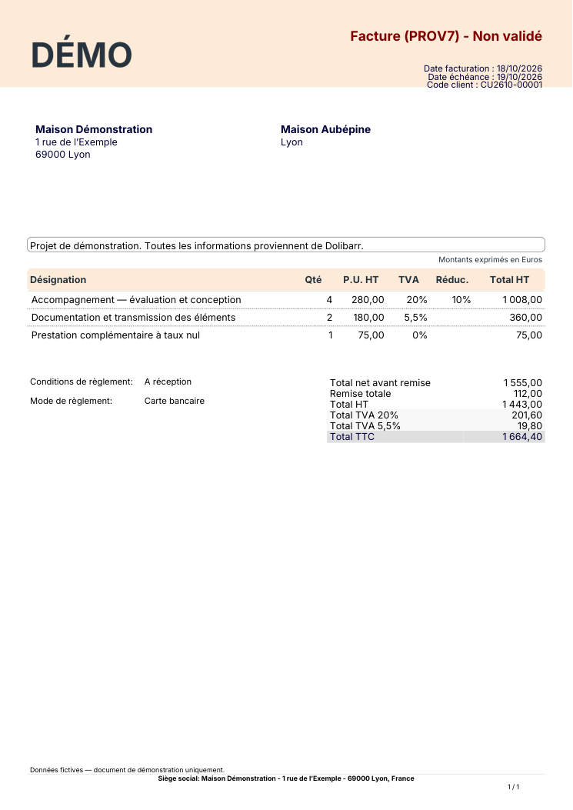

# Factures Indy

Un modèle PDF natif pour Dolibarr 24.0.2, inspiré d’une facture à bandeau crème et tableau épuré. Le modèle s’appelle **indy** dans la liste des générateurs. Son style est indépendant du thème de l’interface web.

[Voir un exemple PDF avec des données fictives](docs/exemple-facture-indy.pdf).

## Installer et activer dans ce template

Le code et la police sont inclus dans l’image Docker. Le module est installé dans `htdocs/indyinvoice`, parmi les répertoires que Dolibarr détecte nativement. Son code suit la version de l’image et ses réglages restent dans MariaDB. Le dossier persistant des modules externes reste disponible pour les autres extensions.

1. Déployer une image contenant ce module.
2. Dans **Accueil → Configuration → Modules / Applications**, rechercher **Factures Indy** et activer le module.
3. Ouvrir sa roue de configuration : **Présentation des factures Indy**.
4. Choisir les couleurs, la hauteur du bandeau, la police, sa taille et le style du tableau.
5. Cocher **Utiliser indy par défaut** puis enregistrer pour les prochaines générations. L’activation seule ajoute le modèle sans remplacer un choix existant.

Sur une facture, dans **Documents**, choisir **indy** puis **Générer**. Cela utilise les informations actuelles de cette facture. Aucun document déjà généré n’est réécrit par l’activation ou le changement des couleurs. Le bouton de génération natif peut remplacer le PDF principal de cette facture : conserver une copie du fichier existant si nécessaire.

Le bouton **Aperçu** du modèle, dans les réglages natifs du module Factures, génère un spécimen sans créer ni valider de facture métier.

## Ce qui reste piloté par Dolibarr

| Élément | Réglage ou donnée utilisée |
| --- | --- |
| Logo et coordonnées de l’émetteur | Configuration → Société / Organisation |
| Client et contact de facturation | Fiche du tiers et contacts de la facture |
| Numéro, dates, référence client | Facture et module de numérotation natif |
| Produits, services, unités et descriptions | Lignes de facture ; les unités apparaissent si leur option native est activée |
| Quantités, remises, TVA, totaux, avoirs et paiements | Calculs du générateur natif Sponge |
| Échéance et mode de règlement | Facture et dictionnaires natifs |
| Coordonnées bancaires | Compte bancaire lié à la facture ou réglage natif du module Factures |
| Texte libre et mentions | Configuration du module Factures ; options PDF natives |
| Marges, langue et informations légales | Réglages PDF et société natifs |
| Bandeau, police et tableau Indy | Configuration du module Factures Indy |

Le modèle ne contient aucun nom, adresse, numéro fiscal, taux de TVA imposé, IBAN ou condition de règlement d’une entreprise réelle. Renseigner les informations de l’émetteur dans Dolibarr, ainsi que les mentions correspondant à sa situation. La présentation n’ajoute aucune certification ni fonction de facturation électronique.

## Présentation

Par défaut : bandeau et en-tête du tableau **#FCEBD8**, police **Inter**, taille de base **11 points**, tableau sans grandes bordures verticales. Les totaux suivent les dernières lignes lorsque la place réservée par le générateur natif le permet. Le mode **Encadré** conserve la structure du tableau Sponge.

Inter est embarquée pour les caractères latins et accents français. **DejaVu Sans** est proposée pour d’autres alphabets ; **Helvetica** est aussi disponible. Les polices Inter sont dérivées du fichier fourni avec le thème du dépôt, aux graisses 400 et 700, puis converties au format TCPDF. Licence : [SIL OFL](fonts/OFL.txt).

Le modèle hérite de Sponge plutôt que de recopier ses calculs. Les surcharges de présentation sont temporaires pendant la génération : les préférences PDF des autres modèles ne sont pas modifiées. Les documents multidevises et bilingues utilisent le tableau natif pour conserver ses libellés et indications de change. Les modules tiers ou mises à jour majeures de Dolibarr doivent être vérifiés avant mise en production.

## Comprendre le fichier ODT fourni par Dolibarr

`template_invoice.odt` est un document LibreOffice Writer présentant les balises disponibles, pas une facture finalisée. Dolibarr remplace ces balises lors de la génération :

| Balise | Valeur injectée |
| --- | --- |
| `{mycompany_logo}` | Logo de la société |
| `{mycompany_name}` | Nom de l’émetteur |
| `{company_name}` | Client |
| `{object_ref}` | Numéro de facture |
| `{object_date}` et `{object_date_limit}` | Date et échéance |
| `{object_total_ht_locale}` et `{object_total_ttc_locale}` | Totaux formatés selon la langue |
| `{line_fulldesc}`, `{line_qty}`, `{line_up}`, `{line_price_ht}` | Description, quantité, prix unitaire et total de la ligne |

Pour construire un modèle ODT : ouvrir une copie dans LibreOffice, composer le bandeau, les tableaux et les styles, puis placer les balises dans les cellules. La ligne à répéter doit commencer par `[!-- BEGIN row.lines --]` et se terminer par `[!-- END row.lines --]`, à l’intérieur de cette même ligne du tableau. Préserver les balises d’un seul tenant, sans changer de mise en forme au milieu de leurs caractères.

Déposer ensuite l’ODT dans le répertoire de modèles indiqué par les réglages natifs du module Factures, généralement `documents/doctemplates/invoices`, et activer le générateur ODT. Les fichiers de ce répertoire sont persistants dans ce template. Le document généré peut être ouvert dans LibreOffice pour être exporté en PDF. La conversion automatique ODT → PDF sur le serveur demande un convertisseur configuré ; ce template n’installe pas LibreOffice. Le modèle PDF **indy** produit directement le PDF avec TCPDF, sans cette conversion.

Références : [modèles ODT](https://wiki.dolibarr.org/index.php/Create_an_ODT_document_template), [modèles PDF](https://wiki.dolibarr.org/index.php/Create_a_PDF_document_template), [Sponge de Dolibarr 24.0.2](https://github.com/Dolibarr/dolibarr/blob/24.0.2/htdocs/core/modules/facture/doc/pdf_sponge.modules.php).

## Tests et maintenance

La CI génère six scénarios avec de seules données fictives : remises avec plusieurs taux de TVA, taux nul, avoir, facture longue de 48 lignes, tableau encadré et police Unicode. Elle contrôle les totaux natifs, les lignes, les polices embarquées, les en-têtes et pieds de page, les limites des pages, ainsi que l’enregistrement des préférences et la vue mobile. Les PDF et captures sont disponibles dans l’artefact de la CI.

Le code du module est sous **GPL v3 ou ultérieure**, comme sa classe parente Dolibarr. Inter conserve sa licence SIL OFL. Le numéro technique `500987` est propre à ce projet et n’est pas une réservation DoliStore. Aucun service Indy ni logo propriétaire n’est intégré.
